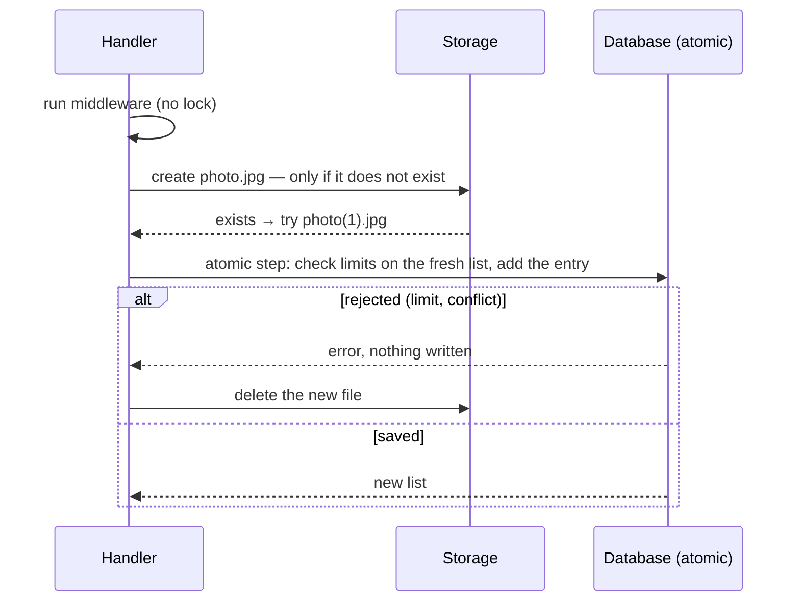

# Concurrent Writes

By default the handler changes the entity in memory and your application saves the `attachments` column. That is simple, but two requests that change the same entity at the same time each save their own copy, and the later save wins: a file uploaded by the other request disappears from the list. This chapter shows the optional **atomic mode**, in which the package saves every change itself through a function you provide, so concurrent requests — in one process or across many instances — never overwrite each other.

## When you need it

Use atomic mode when the same entity's files can change from more than one request at once: several uploads into a gallery, two users editing the same record, a background job next to user actions, or several application instances. If every entity is only ever changed by one request at a time, the default mode is enough.

Atomic mode is opt-in. Without it nothing changes, and the stored data is the same in both modes, so you can switch at any time without migration.

## Enabling atomic mode

Pass an `atomic` function to `defineAttachments`:

```ts
const attachments = defineAttachments({
  user:   defineAttachments.entity({ avatar: { code: 'AV', middlewares: [count(1)] } }),
  course: defineAttachments.entity({ gallery: { code: 'GA' } }),
}, {
  provider: createLocalProvider('./var/uploads'),
  atomic:   atomicUpdate,   // see below
});
```

One function serves every entity: it receives the entity type and id. To use atomic mode for one entity only, or a different function for it, set `atomic` in that entity's options instead:

```ts
user: defineAttachments.entity({ avatar: { code: 'AV' } }, { atomic: atomicUpdate }),
```

### The `atomic` function

```ts
type AtomicFn = (
  ctx: { entityType: string; entityId: string; entity: Record<string, unknown> },
  mutate: (current: unknown) => unknown,
) => Promise<unknown>;
```

It must read the current value of the entity's `attachments` column, call `mutate` with it, write the result, and return the written value — with no other write to that column in between. How you guarantee that is up to you and your database; the two usual ways are a row lock in a transaction and a compare-and-set with retry.

- `mutate` is pure and synchronous. It may be called more than once (for retries).
- When `mutate` throws (file not found, limit reached, name taken), write nothing and let the error propagate.
- The lock or the retry covers only this short step. Uploads and middleware run outside it, so a slow upload never blocks other changes of the entity.

> [!warning] Only the package writes the column
> In atomic mode never write `attachments` yourself, and never save a whole loaded row back over it (for example `update({ data: { ...user } })`): that would overwrite changes made by other requests in the meantime.

### Prisma: row lock in a transaction

The row is locked only while the list is being changed. Works with PostgreSQL and MySQL; the names in `entityType` must match your Prisma models.

```ts
import { Prisma, PrismaClient } from '@prisma/client';
import type { AtomicFn } from '@atom-forge/attachment';

const prisma = new PrismaClient();
const tables: Record<string, string> = { user: 'User', course: 'Course' };   // Prisma model → table

const atomicUpdate: AtomicFn = ({ entityType, entityId }, mutate) =>
  prisma.$transaction(async (tx) => {
    const id = Number(entityId);
    const [row] = await tx.$queryRaw<{ attachments: unknown }[]>`
      SELECT attachments FROM ${Prisma.raw(`"${tables[entityType]}"`)} WHERE id = ${id} FOR UPDATE`;
    const next = mutate(row.attachments);
    await (tx as any)[entityType].update({ where: { id }, data: { attachments: next } });
    return next;
  });
```

For MySQL, quote the table name with backticks instead of double quotes.

### Prisma: compare-and-set

No raw SQL: the write succeeds only if the column still holds the value that was read; otherwise it reads again and retries. Every write compares the whole JSON value, so this costs more with long lists. Check that your Prisma version supports JSON filters for your database.

```ts
const atomicUpdate: AtomicFn = async ({ entityType, entityId }, mutate) => {
  const model = (prisma as any)[entityType];
  const id = Number(entityId);
  for (;;) {
    const row  = await model.findUniqueOrThrow({ where: { id }, select: { attachments: true } });
    const next = mutate(row.attachments);
    const { count } = await model.updateMany({
      where: { id, attachments: { equals: row.attachments ?? Prisma.DbNull } },
      data:  { attachments: next },
    });
    if (count) return next;
  }
};
```

## What changes in your code

The operations save themselves, so the save-and-rollback step of the default mode disappears:

```ts
// default mode
const { attachment, rollback } = await h.avatar.add(file, {});
try {
  await prisma.user.update({ where: { id }, data: { attachments: user.attachments as object } });
} catch (err) {
  await rollback();
  throw err;
}

// atomic mode
const attachment = await h.avatar.add(file, {});
```

| Operation | Default mode | Atomic mode |
|---|---|---|
| `add`, `replace` | `{ attachment, rollback }`, you save | `AttachmentData`, saved |
| `updateMeta` | synchronous, you save | `Promise<AttachmentData>`, saved |
| `reorder` | synchronous, you save | `Promise<void>`, saved |
| `rename`, `delete` | you save | saved |
| `list`, `get` | unchanged | unchanged |
| `purge` | you save | you save (it runs after the entity is deleted) |

The return types follow the option: TypeScript knows which mode an entity is in. After each change, `entity.attachments` holds the saved value, so reading it needs no extra query.

## How it works

Every operation does its slow storage work first and then changes the list in one short atomic step. The storage itself prevents conflicts: a new file is only created where nothing exists yet, and a file is only overwritten if it has not changed since it was read.



| Operation | Order |
|---|---|
| `add` | create the file under a free name → atomic: check limits, add the entry |
| `replace` | overwrite only if unchanged since read → atomic: update the entry; deleted meanwhile → remove the new file, throw |
| `rename` | copy to the new name (only if free) → atomic: rename the entry → delete the old file |
| `delete` | atomic: remove the entry → delete the file |
| `updateMeta`, `reorder` | atomic step only, on the fresh list |

On the first upload into a category, a short atomic step creates the group, so concurrent first uploads end up in one group.

### Limits

Limits that depend on the other files — `count()` and `sumSize()` — run twice: once before the upload, on the list the request loaded, and again in the atomic step, on the fresh list. Concurrent uploads therefore cannot exceed them. A custom middleware with such a limit should provide the same `check` part (see *Upload Middleware*).

### Orphan files

Storage and database are separate systems, so a crash between the two steps can leave a file that is not in the list. Such an orphan never appears to users, and never blocks a name for good: after every upload, replacement, rename or deletion in a category, the package lists the group's folder and deletes the files that are not in the list and are older than `orphanAge` (default: one day). The age limit protects uploads that are still in progress, so keep it well above your longest upload. `purge()` deletes everything in the group folders, orphans included.

| Situation | Result |
|---|---|
| Upload fails | no entry; the file is deleted |
| Upload rejected (limit, conflict) | no entry; the file is deleted |
| Process crashes after the upload, before the save | an orphan file, deleted after a later upload, replacement, rename or deletion in the category |
| Database fails after writing | the file is kept, the entry may already be saved; the cleanup removes the file only if it is really not listed |

## Storage requirements

Atomic mode needs five extra provider methods; the local and the S3 provider have them, and `defineAttachments` throws at startup if a provider lacks one.

| Method | Purpose | Local | S3 |
|---|---|---|---|
| `create(path, file)` | save only if nothing exists there | temporary file + `link()` | `PutObject` with `If-None-Match: *` |
| `copy(from, to)` | copy only if the target is free | `copyFile` with `COPYFILE_EXCL` | `CopyObject` with `If-None-Match: *` |
| `list(folder)` | files of a group folder with their age | `readdir` + `stat` | `ListObjectsV2` |
| `etag(path)` | token of the current content | inode, mtime and size | `ETag` |
| `replaceIf(path, file, etag)` | overwrite only if the token still matches | temporary file + `rename()` | `PutObject` with `If-Match` |

For S3 the credentials need `s3:ListBucket` besides read, write and delete. S3-compatible services must support conditional writes (`If-None-Match`, `If-Match`); check yours before enabling atomic mode.

## Known limits

- **Local storage shared between machines** (for example over NFS): the "overwrite only if unchanged" check and the overwrite are two steps. Within one process they are exact; between processes on different machines a window of microseconds remains.
- **A crash during `replace`**, between overwriting the file and saving the list, leaves the new content in the file while the list still shows the old size and metadata, until the next change of that file. The old content cannot be restored, because the file keeps its name.
- **Orphans of entities that are never changed again** stay until the entity is purged.
- A custom middleware whose limit depends on the other files but has no `check` only sees the list the request loaded.
