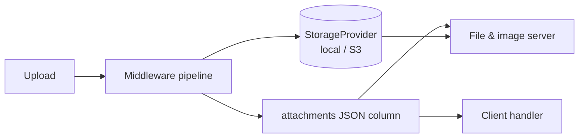
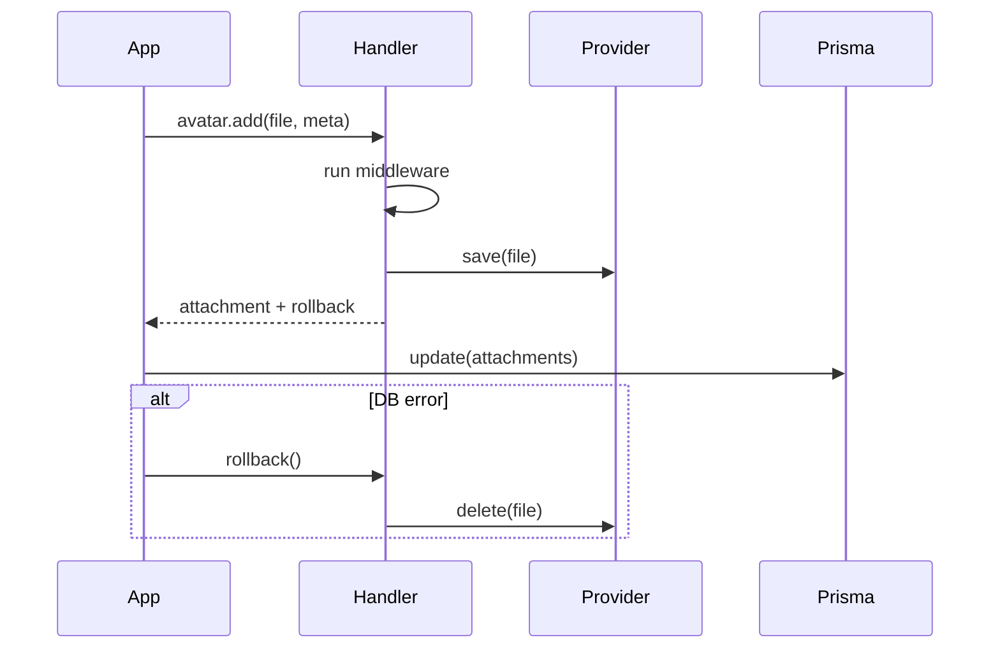

# Getting Started

This chapter takes you from an empty project to a working upload in four steps: define what can be attached, upload a file, read it back on the server, and finally read it in the browser without an extra API call. Along the way you will meet the main ideas of the library: *categories*, the *handler* and the *middleware pipeline*.

## What it does

- Attaches files to any Prisma entity via a `Json?` column called `attachments`
- Supports multiple **categories** per entity (e.g. `avatar`, `gallery`, `documents`)
- Validates and transforms uploads via a composable **middleware pipeline**
- Generates cache-busted serving URLs automatically
- Provides on-demand **thumbnail generation** for images (WebP output, flat disk cache)
- Ships a typed **client-side handler** that reads entity data directly — no extra API call

The diagram shows how the pieces fit together. An upload passes through the middleware pipeline and ends up in two places: the file goes to storage and its metadata goes into the JSON column. Everything read later, by the client handler or the file and image servers, comes from those two places.



## Installation

```sh
npm install @atom-forge/attachment
```

### Peer dependencies

| Package          | Version  | Required by                                    |
|------------------|----------|------------------------------------------------|
| `sharp`          | `>=0.32` | `toWebP()`, `imgstat()`, `generateImage()`     |
| `music-metadata` | `>=11`   | `getMp3Duration()`                             |

Peer deps are optional at the package level — import only what you use.

---

## 1. Define your attachment schema

```ts
import { defineAttachments, count, mime, toWebP, imgstat } from '@atom-forge/attachment';
import { createLocalProvider } from '@atom-forge/attachment';

const attachments = defineAttachments({
  user: defineAttachments.entity({
    avatar:  { code: 'AV', middlewares: [count(1), mime('image/*'), toWebP(80, 400, 400), imgstat()] },
    gallery: { code: 'GA', middlewares: [mime('image/*'), toWebP(80)] },
  }, { idType: 'uuid' }),

  course: defineAttachments.entity({
    avatar: { code: 'CA', middlewares: [count(1), mime(['image/jpeg', 'image/png', 'image/webp'])] },
  }),
}, {
  provider:    createLocalProvider('./var/uploads'),
  servePrefix: '/file',
  // nextGroupId: optional — defaults to crypto.randomUUID() → base36
  // It produces only the random part of the group ID and must return lowercase base36 ([a-z0-9]+):
  // nextGroupId: async (entityType, entityId, category) => myIdGenerator(...)
});
```

`defineAttachments.entity(categories, options?)` defines one entity type.
`idField` tells the handler which field on the entity is the primary key (default: `'id'`).
`idType` tells how that id is encoded (in base36) into the group ID: `'int'` (default) or `'uuid'`. String/slug ids are not supported.

Every category is an object with a mandatory `code`: exactly two characters `[A-Z0-9]`, unique across all categories of one `defineAttachments` call (that is why `course.avatar` is `CA`, not `AV`, above). It is validated at startup: a missing, malformed or duplicate code, or an array-form category, throws. Optional fields: `middlewares`, `authorize` (an access check on every file and thumbnail request) and `provider` (per-category storage) — see *Access Control*.

The code is part of the group ID, which is also the storage folder: `{random}-{CODE}-{entityId36}`, e.g. `k3x9q-CA-39x9` (`39x9` is `152829` in base36).

---

## 2. Upload a file

```ts
const userRecord = await prisma.user.findUniqueOrThrow({ where: { id: userId } });
const h = attachments.user(userRecord);

const { attachment, rollback } = await h.avatar.add(uploadedFile, {});
try {
  await prisma.user.update({
    where: { id: userId },
    data:  { attachments: userRecord.attachments as object },
  });
} catch (err) {
  await rollback();   // deletes the physical file on DB failure
  throw err;
}
```

Attachments can only be added to a **saved** entity: its id must exist and match `idType`, otherwise `add` throws with a clear message.

> [!warning] Persist yourself
> The handler **mutates `entity.attachments` in-place** — you must call `prisma.update` yourself to persist.

The sequence below is what step 2 does behind the scenes. Notice that the handler returns a `rollback` function: if saving to the database fails, you can use it to remove the file that was just stored, so no orphaned files are left behind.



---

## 3. Read files on the server

```ts
const h = attachments.user(userRecord);

h.avatar.list()           // AttachmentData[]
h.avatar.get('photo.jpg') // AttachmentData | undefined
```

---

## 4. Client-side handler

The client-side handler reads the entity's `attachments` JSON directly — no server round-trip required.

```ts
import { makeAttachmentHandler } from '@atom-forge/attachment/client';
import { imageVariants } from './image-variants.js';

const h = makeAttachmentHandler(imageVariants, { servePrefix: '/file', thumbPrefix: '/img' });

const item = h.course(course).avatar.first;  // ItemView | undefined
const all  = h.user(user).gallery.all;       // ItemView[]

item?.filename          // 'photo.jpg'
item?.url               // '/file/k3x9q-CA-39x9-1r2jo3l/photo.jpg'
item?.meta              // unknown — cast to your meta type
item?.img.avatar()      // '/img/k3x9q-CA-39x9-1r2jo3l/e.400x400/photo.jpg.webp'
item?.img.avatar(2)     // '/img/k3x9q-CA-39x9-1r2jo3l/e.800x800/photo.jpg.webp'  (2x retina)
```

> [!note] Client import
> In browser/SSR components import from `@atom-forge/attachment/client`. The main package re-exports Node.js server modules.
