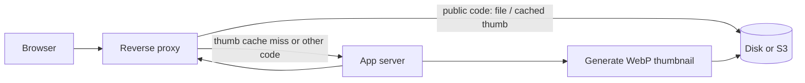

# Serving Files

Uploaded files are only useful when browsers can fetch them. This chapter shows how to expose files and thumbnails, first through your web framework and then, for production, through a reverse proxy that serves the bulk of the traffic without touching your application. It ends with cache cleanup and the environment variables you can set.

`createFileServer` and `createImageServer` both return a handler with the same two methods:

```ts
interface Handler {
  match(request: Request): boolean;            // does the path start with the handler's prefix?
  handle(request: Request): Promise<Response>; // serve it (404 / 403 / 400 responses included)
}
```

Both work with the [Web Standard](https://developer.mozilla.org/en-US/docs/Web/API/Request) `Request` and `Response`, available natively in Node 20+, Bun and Deno. Call `match` first; when it returns `false`, pass the request on to your framework. The handlers take the whole `Request`, not only its path, because categories with `authorize` need its headers (for example cookies).

The file and image servers use Node APIs (`node:fs`, `node:crypto`, `sharp`), so run them in a Node-compatible runtime, not on the edge.

### `createFileServer` options

| Option | Default | Meaning |
|---|---|---|
| `attachments` | — | Required. The `defineAttachments` result: the category code in each URL selects the category, its provider and its `authorize` hook. |
| `servePrefix` | `'/file'` | URL prefix; must match `defineAttachments` and the proxy. |

There is no storage option: each file is streamed by its category's provider (the category-level `provider`, or the `defineAttachments` provider).

| Request | Response |
|---|---|
| Unknown code, malformed or tampered group id, unsafe filename, missing file | `404` |
| `authorize` returned `false` | `403` |
| Category without `authorize` | `200`, `Cache-Control: public, max-age=31536000, immutable` |
| Category with `authorize`, allowed | `200`, `Cache-Control: private, no-store` |

### `createImageServer` options

| Option | Default | Meaning |
|---|---|---|
| `attachments` | — | Required. The `defineAttachments` result: the original image is read from the category's provider, and `authorize` runs for authorized categories. |
| `variants` | — | The shared image variant map (the same one the client uses). |
| `thumbProvider` | — | Where generated thumbnails are cached. |
| `thumbPrefix` | `'/img'` | URL prefix of thumbnails. |
| `focusSecret` | — | Secret for manual-focus URL hashes. |
| `eventManager` | — | Optional. Receives `thumbnail:generated` (`{ groupId, filename, modeSeg }`) after a new thumbnail is generated and cached. |

Thumbnails of authorized categories are served too: `authorize` runs on every request and the response is `Cache-Control: private, no-store`.

## URL schemas

```
Raw file:  GET /{servePrefix}/{groupId}-{version}/{filename}
Thumbnail: GET /{thumbPrefix}/{groupId}-{version}/{mode-segment}/{filename}.webp

groupId:   {random}-{CODE}-{entityId36}
Example:   /file/k3x9q-PD-39x9-1r2jo3l/contract.pdf
```

Default prefixes: `/file` and `/img`. The group id is the store's storage folder: `random` is lowercase base36 (unguessable), `CODE` is the category's two-character code, `entityId36` is the owner's id in base36 (`39x9` = 152829). The version is a base36 counter plus random characters. Filenames are percent-encoded in URLs.

> [!note] Access control
> Whether a category is public or authorized is decided only by its `authorize` hook and by the reverse proxy allow-list. See *Access Control*.

---

## Framework integrations

All examples use one small helper that tries both handlers:

```ts
// attachments.server.ts
import { createFileServer, createImageServer } from '@atom-forge/attachment';

export const fileServer  = createFileServer({ attachments });
export const imageServer = createImageServer({ attachments, variants, thumbProvider, focusSecret });

export async function serveAttachments(request: Request): Promise<Response | null> {
  if (fileServer.match(request))  return fileServer.handle(request);
  if (imageServer.match(request)) return imageServer.handle(request);
  return null;
}
```

### SvelteKit

```ts
// src/hooks.server.ts
import type { Handle } from '@sveltejs/kit';

export const handle: Handle = async ({ event, resolve }) =>
  (await serveAttachments(event.request)) ?? resolve(event);
```

### Hono

```ts
import { Hono } from 'hono';

const app = new Hono();

app.use('*', async (c, next) => (await serveAttachments(c.req.raw)) ?? next());
```

### Express

Express uses its own request and response objects — convert them with a small adapter:

```ts
import express from 'express';
import { Readable } from 'node:stream';

function toWebRequest(req: express.Request): Request {
  const headers = new Headers();
  for (const [key, value] of Object.entries(req.headers)) {
    if (Array.isArray(value)) value.forEach((v) => headers.append(key, v));
    else if (value !== undefined) headers.set(key, value);
  }
  return new Request(new URL(req.originalUrl, `${req.protocol}://${req.get('host')}`), { method: req.method, headers });
}

function sendWebResponse(response: Response, res: express.Response) {
  res.status(response.status);
  response.headers.forEach((value, key) => res.setHeader(key, value));
  if (response.body) Readable.fromWeb(response.body as any).pipe(res);
  else res.end();
}

app.use(async (req, res, next) => {
  const r = await serveAttachments(toWebRequest(req));
  if (!r) return next();
  sendWebResponse(r, res);
});
```

> [!note] Mount path
> Mount the middleware without a path: the handlers check the prefix themselves, and `req.originalUrl` keeps the full URL either way.

### Next.js (App Router)

Use route handlers on the Node runtime (`app/file/[...path]/route.ts`, and the same in `app/img/[...path]/route.ts`):

```ts
export const runtime = 'nodejs';

export async function GET(request: Request) {
  return (await serveAttachments(request)) ?? new Response('Not found', { status: 404 });
}
```

### Nuxt 3 / Nitro

```ts
// server/middleware/attachments.ts
export default defineEventHandler(async (event) => {
  const r = await serveAttachments(toWebRequest(event));
  if (r) return sendWebResponse(event, r);
});
```

In production, a reverse proxy usually sits in front of your application. The diagram shows who answers what: files and already generated thumbnails of public categories are served straight from disk or S3; the app server generates thumbnails that do not exist yet and handles every request of a category with `authorize`.



> [!tip] Why a proxy?
> Raw files and cached thumbnails are immutable (the URL contains the version), so a proxy can serve the public ones with a one-year `Cache-Control` and the app server only handles thumbnail cache misses and authorized categories.

---

## Security headers

`createFileServer` sends `X-Content-Type-Options: nosniff` with every file. Types a browser would run on your origin (HTML, XHTML, SVG, XML, JavaScript) are also sent with `Content-Disposition: attachment` and `Content-Security-Policy: default-src 'none'; sandbox`, so an uploaded page or SVG cannot run scripts in your site's context. When the proxy serves files directly, add the same headers there, for example in Nginx:

```nginx
# http {} level
map $uri $attachment_disposition {
    "~*\.(html?|xhtml|svg|xml|js)$"  attachment;
    default                           "";
}
map $uri $attachment_csp {
    "~*\.(html?|xhtml|svg|xml|js)$"  "default-src 'none'; sandbox";
    default                           "";
}

# inside each location that serves /file directly
add_header X-Content-Type-Options  nosniff                  always;
add_header Content-Disposition     $attachment_disposition  always;  # empty value = header not sent
add_header Content-Security-Policy $attachment_csp          always;
```

Still restrict uploads with `ext()`/`mime()` where possible: `mime()` checks the type the client sends, which a client can fake.

---

## Proxy configuration

A reverse proxy in front of the app server can serve the raw files and cached thumbnails of **public** categories directly. The app server then receives only thumbnail cache misses and the requests of categories with `authorize`.

### Public codes allow-list

The proxy decides by the category code inside the group id. Keep an allow-list of the codes of public categories (categories without `authorize`), serve only those directly, and send everything else under `/file/` and `/img/` to the application. `publicCodes(attachments)` returns exactly these codes, so you can build the pattern from your definition:

```ts
import { publicCodes } from '@atom-forge/attachment';

console.log(publicCodes(attachments).join('|'));  // AV|GA|CV
```

The examples below use `AV|GA|CV`; replace it with your own list.

- **Fail-safe:** a public code missing from the list is not an error — its files simply go through the application, which serves them with the same `Cache-Control`.
- Proxy rules from older versions (`^/file/([a-z0-9]+)-[a-z0-9]+/`) do not match the current URLs at all: until you update them, every request goes through the application (safe, only slower).

> [!warning] Never list a code that has `authorize`
> The proxy would serve those files without calling `authorize`. Thumbnails of authorized categories are cached in `thumbProvider` too, so this applies to `/img` as well.

See *Access Control* for the full model.

### Path derivation

**`/file` → local filesystem:**
```
/file/k3x9q-AV-39x9-1r2jo3l/photo.jpg
      └─────┬─────┘ └──┬──┘
         groupId    version (after the last dash)
groupId = k3x9q-AV-39x9 ({random}-{CODE}-{entityId36}), shard = k3 (first 2 chars)
→ /var/uploads/k3/k3x9q-AV-39x9/photo.jpg
```

**`/file` → S3/MinIO** (shard stripped — object storage needs no directory sharding):
```
/file/k3x9q-AV-39x9-1r2jo3l/photo.jpg  →  k3x9q-AV-39x9/photo.jpg
```

**`/img` → flat cache key:**
```
/img/k3x9q-AV-39x9-1r2jo3l/e.400x400/photo.jpg.webp
→  k3x9q-AV-39x9-1r2jo3l.e.400x400.photo.jpg.webp   (slashes → dots)
```

The public-code part of every pattern below is `-(?:AV|GA|CV)-`: the code sits between the random part and the encoded entity id.

---

### Local provider — `/file`

#### Nginx
```nginx
# Public codes: served directly
location ~ "^/file/(?<shard>[a-z0-9]{2})(?<rest>[a-z0-9]*-(?:AV|GA|CV)-[a-z0-9]+)-[a-z0-9]+/(?<filename>.+)$" {
    alias /var/uploads/$shard/$shard$rest/$filename;
    add_header Cache-Control "public, max-age=31536000, immutable";
}
# Everything else under /file/ → the application
location /file/ {
    proxy_pass http://localhost:3000;
}
```

#### Apache
```apache
RewriteEngine On
# Public codes: served directly
RewriteRule "^/file/([a-z0-9]{2})([a-z0-9]*-(?:AV|GA|CV)-[a-z0-9]+)-[a-z0-9]+/(.+)$" "/var/uploads/$1/$1$2/$3" [L]
# Everything else under /file/ → the application
RewriteRule "^/file/" "http://localhost:3000%{REQUEST_URI}" [P,L]

<Directory "/var/uploads">
    Options -Indexes
    Require all granted
    Header always set Cache-Control "public, max-age=31536000, immutable"
</Directory>
```

#### Caddy
```caddyfile
@rawfile path_regexp rawfile "^/file/([a-z0-9]{2})([a-z0-9]*-(?:AV|GA|CV)-[a-z0-9]+)-[a-z0-9]+/(.+)$"
handle @rawfile {
    root * /var/uploads
    rewrite * /{http.regexp.rawfile.1}/{http.regexp.rawfile.1}{http.regexp.rawfile.2}/{http.regexp.rawfile.3}
    file_server
    header Cache-Control "public, max-age=31536000, immutable"
}
handle /file/* { reverse_proxy localhost:3000 }
```

---

### Local provider — `/img`

Cached thumbnails of public codes are served from disk. Cache misses and every other code are proxied to the app server, which runs `authorize` where needed, generates and writes the thumbnail, then returns it.

#### Nginx
```nginx
location ~ "^/img/([a-z0-9]+-(?:AV|GA|CV)-[a-z0-9]+-[a-z0-9]+)/([^/]+)/(.+)$" {
    root /var/thumb;
    try_files /$1.$2.$3 @generate;
    add_header Cache-Control "public, max-age=31536000, immutable";
}
location @generate {
    proxy_pass http://localhost:3000;
}
# Everything else under /img/ → the application
location /img/ {
    proxy_pass http://localhost:3000;
}
```

#### Apache
```apache
RewriteEngine On
RewriteRule "^/img/([a-z0-9]+-(?:AV|GA|CV)-[a-z0-9]+-[a-z0-9]+)/([^/]+)/(.+)$" - [E=FLATKEY:$1.$2.$3,C]
RewriteCond "/var/thumb/%{ENV:FLATKEY}" -f
RewriteRule "^/img/([^/]+)/([^/]+)/(.+)$" "/thumbcache/$1.$2.$3" [PT,L]
RewriteRule "^/img/" "http://localhost:3000%{REQUEST_URI}" [P,L]

Alias "/thumbcache" "/var/thumb"
<Directory "/var/thumb">
    Options -Indexes
    Require all granted
    Header always set Cache-Control "public, max-age=31536000, immutable"
</Directory>
```

#### Caddy
```caddyfile
@thumbOnDisk {
    path_regexp thumb "^/img/([a-z0-9]+-(?:AV|GA|CV)-[a-z0-9]+-[a-z0-9]+)/([^/]+)/(.+)$"
    file { root /var/thumb; try_files /{http.regexp.thumb.1}.{http.regexp.thumb.2}.{http.regexp.thumb.3} }
}
handle @thumbOnDisk {
    root * /var/thumb
    rewrite * /{http.regexp.thumb.1}.{http.regexp.thumb.2}.{http.regexp.thumb.3}
    file_server
    header Cache-Control "public, max-age=31536000, immutable"
}
handle /img/* { reverse_proxy localhost:3000 }
```

---

### S3 / MinIO — `/file` with a `files/` prefix

The examples below assume the `defineAttachments` provider uses `prefix: 'files/'`. Omit `files/`
from each rewritten target when no prefix is configured. Serving straight from the bucket requires
anonymous read access to that prefix, so categories with `authorize` must use a separate, non-public
`provider` (see *Access Control*).

#### Nginx
```nginx
# AWS S3
location ~ "^/file/[a-z0-9]+-(?:AV|GA|CV)-[a-z0-9]+-[a-z0-9]+/" {
    rewrite "^/file/([a-z0-9]+-(?:AV|GA|CV)-[a-z0-9]+)-[a-z0-9]+/(.+)$" /files/$1/$2 break;
    proxy_pass https://my-bucket.s3.eu-central-1.amazonaws.com;
    proxy_ssl_server_name on;
    proxy_set_header Host my-bucket.s3.eu-central-1.amazonaws.com;
}

# MinIO
location ~ "^/file/[a-z0-9]+-(?:AV|GA|CV)-[a-z0-9]+-[a-z0-9]+/" {
    rewrite "^/file/([a-z0-9]+-(?:AV|GA|CV)-[a-z0-9]+)-[a-z0-9]+/(.+)$" /my-bucket/files/$1/$2 break;
    proxy_pass http://minio:9000;
}

# Everything else under /file/ → the application
location /file/ {
    proxy_pass http://localhost:3000;
}
```

#### Apache
```apache
RewriteEngine On
# AWS S3
RewriteRule "^/file/([a-z0-9]+-(?:AV|GA|CV)-[a-z0-9]+)-[a-z0-9]+/(.+)$" \
    "https://my-bucket.s3.eu-central-1.amazonaws.com/files/$1/$2" [P,L]
# MinIO
RewriteRule "^/file/([a-z0-9]+-(?:AV|GA|CV)-[a-z0-9]+)-[a-z0-9]+/(.+)$" \
    "http://minio:9000/my-bucket/files/$1/$2" [P,L]
# Everything else under /file/ → the application
RewriteRule "^/file/" "http://localhost:3000%{REQUEST_URI}" [P,L]
```

#### Caddy
```caddyfile
@rawfile path_regexp rawfile "^/file/([a-z0-9]+-(?:AV|GA|CV)-[a-z0-9]+)-[a-z0-9]+/(.+)$"
# AWS S3
handle @rawfile {
    rewrite * /files/{http.regexp.rawfile.1}/{http.regexp.rawfile.2}
    reverse_proxy https://my-bucket.s3.eu-central-1.amazonaws.com {
        header_up Host my-bucket.s3.eu-central-1.amazonaws.com
    }
}
handle /file/* { reverse_proxy localhost:3000 }
```

---

### S3 / MinIO — `/img` with an `images/` prefix

The example below assumes `thumbProvider` uses `prefix: 'images/'`. Replace
`my-bucket/images` with the thumbnail bucket name when using separate buckets.
The thumbnail cache also holds thumbnails of authorized categories, so do not make it
anonymously readable as a whole if you have any.

#### Nginx
```nginx
location ~ "^/img/[a-z0-9]+-(?:AV|GA|CV)-[a-z0-9]+-[a-z0-9]+/" {
    rewrite "^/img/([a-z0-9]+-(?:AV|GA|CV)-[a-z0-9]+-[a-z0-9]+)/([^/]+)/(.+)$" /my-bucket/images/$1.$2.$3 break;
    proxy_pass http://minio:9000;
    proxy_intercept_errors on;
    error_page 404 = @generate;
}
location @generate {
    proxy_pass http://localhost:3000$request_uri;
}
# Everything else under /img/ → the application
location /img/ {
    proxy_pass http://localhost:3000;
}
```

#### Apache

> [!warning] Apache limitation
> Apache does not cleanly support "try upstream A, fall back to upstream B on 404". Route all thumbnail requests through the app instead:

```apache
ProxyPass        "/img/" "http://localhost:3000/img/"
ProxyPassReverse "/img/" "http://localhost:3000/img/"
```

#### Caddy
```caddyfile
@thumb path_regexp thumb "^/img/([a-z0-9]+-(?:AV|GA|CV)-[a-z0-9]+-[a-z0-9]+)/([^/]+)/(.+)$"
handle @thumb {
    rewrite * /my-thumbs/{http.regexp.thumb.1}.{http.regexp.thumb.2}.{http.regexp.thumb.3}
    reverse_proxy http://minio:9000 {
        @miss status 404
        handle_response @miss {
            rewrite * {http.request.orig_uri.path}
            reverse_proxy http://localhost:3000
        }
    }
}
handle /img/* { reverse_proxy localhost:3000 }
```

---

## Thumbnail cache cleanup

When a file is replaced, its version changes and old thumbnails become orphaned. When a file is deleted, the image server stops serving its thumbnails (it checks that the original still exists), but a proxy that serves cached thumbnails directly keeps serving them until this cleanup removes them.

### Local provider

```sh
# Delete thumbnails not accessed in 30 days
find /var/thumb -type f -atime +30 -delete
```

Add to crontab:
```cron
0 3 * * * find /var/thumb -type f -atime +30 -delete
```

### S3 / MinIO — lifecycle rule

```sh
# AWS S3
aws s3api put-bucket-lifecycle-configuration \
  --bucket my-thumbs \
  --lifecycle-configuration '{
    "Rules": [{ "ID": "expire-thumbs", "Status": "Enabled", "Filter": {}, "Expiration": { "Days": 30 } }]
  }'

# MinIO
mc ilm add --expiry-days 30 myminio/my-thumbs
```

---

## Environment variables

The library itself reads no environment variables. The examples in this documentation use the following names; pass their values to the providers and servers yourself.

| Variable       | Default         | Description                                   |
|----------------|-----------------|-----------------------------------------------|
| `UPLOAD_DIR`   | `./var/uploads` | Root directory for uploaded files (passed to `createLocalProvider`) |
| `SERVE_PREFIX` | `/file`         | URL prefix for raw file serving               |
| `THUMB_DIR`    | `./var/thumb`   | Flat cache directory for generated thumbnails |
| `THUMB_PREFIX` | `/img`          | URL prefix for thumbnail serving              |
| `FOCUS_SECRET` | *(required)*    | HMAC secret for manual-focus hash validation  |
