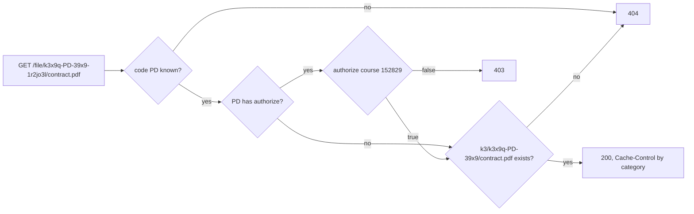

# Access Control

Every category works the same way: it has a code, its files live in a folder named after a composite group id, and the file and image servers serve them. Whether a file is public or needs authorization is decided by two things only: whether its category has an `authorize` hook, and which codes your reverse proxy serves directly.

## The model

- Every category has a two-character `code` (`[A-Z0-9]`), unique across all categories of one `defineAttachments` call.
- Every category store has a composite group id, `{random}-{CODE}-{entityId36}` (e.g. `k3x9q-PD-39x9`), which is also its storage folder.
- A category **without** `authorize` is public: the link is the key. A category **with** `authorize` is authorized: every file and thumbnail request runs the hook.
- The reverse proxy keeps an allow-list of public codes and sends everything else to the application.

| | Public (no `authorize`) | Authorized (`authorize`) |
|---|---|---|
| URL | `/file/k3x9q-CV-39x9-1r2jo3l/cover.webp` | `/file/m7p2a-PD-39x9-4k8tz1q/contract.pdf` |
| Protection | The unguessable random part; the link is the key | `authorize` runs on every file and thumbnail request |
| Served by | The reverse proxy directly (code on the allow-list), otherwise your application | Your application only (`createFileServer`, `createImageServer`) |
| `Cache-Control` | `public, max-age=31536000, immutable` | `private, no-store` |

## Defining `authorize`

Add `authorize` to a category object. One entity can mix public and authorized categories:

```ts
const attachments = defineAttachments({
  course: defineAttachments.entity({
    cover: { code: 'CV', middlewares: [mime('image/*'), toWebP(80)] },   // public
    contracts: {
      code:        'PD',
      middlewares: [mime('application/pdf')],
      authorize:   async ({ request, entityId, filename }) => {
        const user = await getUser(request);
        return user?.canSeeCourse(entityId) ?? false;
      },
    },
  }),
  user: defineAttachments.entity({
    documents: { code: 'UD', authorize: ({ request, entityId }) => isOwner(request, entityId) },
  }, { idType: 'uuid' }),
}, { provider });
```

| Option | Where | Meaning |
|---|---|---|
| `code` | category | Required. Two characters `[A-Z0-9]`, unique across all categories. |
| `authorize` | category | Optional. `({ request, entityType, entityId, category, filename }) => boolean \| Promise<boolean>`; `false` means `403`. |
| `provider` | category | Optional storage just for this category (any category); defaults to the `defineAttachments` provider. Required for authorized categories when the default storage is publicly readable (see *Keep authorized files out of public storage*). |
| `idType` | entity | `'int'` (default) or `'uuid'`: how the entity id is encoded into the group id. |

`defineAttachments` validates codes at startup: a missing, malformed or duplicate code, or an array-form category, throws. Files can only be added to a saved entity, because its id is part of the group id.

## How the URL identifies the owner

The group id is a composite key:

```
k3x9q-PD-39x9
──┬── ┬─ ─┬─
random code entity id (base36)
```

- **random** is lowercase base36. It keeps URLs unguessable (no enumeration), and its first two characters are the shard. A custom `nextGroupId` produces only this part.
- **code** tells the server which entity type and category the file belongs to, so it knows the provider and the `authorize` hook.
- **entity id** is the owner's id in base36 (`39x9` = 152829; `idType: 'uuid'` encodes the 128-bit value). The server decodes it and passes it to `authorize` as a string.

The composite key is also the storage folder (`k3/k3x9q-PD-39x9/contract.pdf`). This is what makes the URL safe to trust: if someone edits the entity id in the URL to one they are allowed to see, `authorize` approves it, but the server then looks for the file in a folder that does not exist and returns `404`.



The handler enforces the same rule on writes: `add` and `replace` throw an `AttachmentValidationError` if a stored group id belongs to a different entity or code (for example because attachment JSON was copied from another record) or is not a composite group id at all.

## Serving

Pass the `defineAttachments` result to both servers; they handle public and authorized categories alike:

```ts
const fileServer  = createFileServer({ attachments });
const imageServer = createImageServer({ attachments, variants, thumbProvider, focusSecret });
```

| Result | Status |
|---|---|
| Unknown code, malformed or tampered group id, or missing file | `404` |
| `authorize` returned `false` | `403` |
| Allowed | `200`, streamed from the category's provider; `private, no-store` for authorized categories, `public, max-age=31536000, immutable` otherwise |

Thumbnails of authorized categories work too: the image server runs `authorize` before serving or generating them and answers with `Cache-Control: private, no-store`. They are still cached in `thumbProvider`, so a proxy must serve only public codes from that cache.

## Reverse proxy

The proxy rules in [Serving Files](serving.md) use an allow-list of **public** codes: those URLs are served directly, everything else under `/file/` and `/img/` goes to your application. Build the list from your definition with `publicCodes(attachments)`, which returns the codes of the categories without `authorize`:

```ts
publicCodes(attachments).join('|');  // e.g. AV|GA|CV
```

```nginx
# Public codes: served directly
location ~ "^/file/(?<shard>[a-z0-9]{2})(?<rest>[a-z0-9]*-(?:AV|GA|CV)-[a-z0-9]+)-[a-z0-9]+/(?<filename>.+)$" {
    alias /var/uploads/$shard/$shard$rest/$filename;
    add_header Cache-Control "public, max-age=31536000, immutable";
}

# Everything else under /file/ (authorized and unlisted codes) → the application
location /file/ {
    proxy_pass http://localhost:3000;
}
```

The list fails safe: a code missing from it only means its files go through the application. Proxy rules from older versions do not match the current URLs, so they send everything to the application too.

> [!warning] Never list an authorized code
> If a code with `authorize` is on the allow-list (or the pattern is widened, for example to `[A-Z0-9]{2}`), the proxy serves those files and their cached thumbnails without calling `authorize`.

## Keep authorized files out of public storage

A category-level `provider` is optional: without one, an authorized category uses the `defineAttachments` provider. Whether you need a separate one depends on whether that storage can be read from outside:

| Setup | Separate provider |
|---|---|
| Local provider (disk) | Not needed: files are reachable only through your proxy and application. |
| S3/MinIO that is not publicly readable (e.g. MinIO on an internal network, or a private bucket whose files are all served by the application) | Not needed, but recommended for a clean separation. |
| S3/MinIO with an anonymously readable bucket or prefix (needed when the proxy serves public files straight from the bucket) | **Required.** Otherwise an authorized file can be downloaded directly from the bucket, bypassing the proxy and `authorize`. |

The library cannot tell whether a bucket is public, so it does not enforce this. When the storage is publicly readable, give authorized categories a provider that is **not**:

```ts
const privateProvider = createS3Provider({ bucket: 'my-bucket', prefix: 'private/' });

contracts: { code: 'PD', authorize, provider: privateProvider },
```

and allow anonymous reads only on the public prefix in the bucket policy. Excluding the authorized keys with a bucket-policy pattern instead is possible but fragile: the deny rule must block anonymous reads without blocking the application's own access. The same applies to the thumbnail cache, which also holds thumbnails of authorized categories.

## Limitations

- **Leaked content.** `authorize` decides per request; a user who is allowed to see a file can still save and share its contents.
- **Adding or removing `authorize` later.** The code and the group ids stay the same, so no files move. Removing `authorize` makes the category's files publicly served by the application (and by the proxy once you add the code to the list). Adding it later protects the existing files too, but first remove the code from the proxy allow-list; copies already fetched with the public, one-year `Cache-Control` may remain in browser or CDN caches.
- **Legacy group ids are not supported.** Plain random group ids from older versions are rejected: `add` and `replace` throw an `AttachmentValidationError`, and the servers return `404`. No migration is provided.
