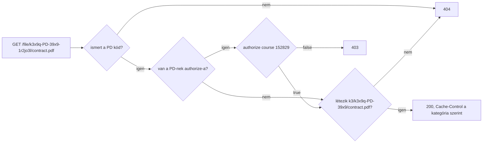

# Hozzáférés-szabályozás

Minden kategória ugyanúgy működik: van egy kódja, a fájljai egy összetett group id-ról elnevezett mappában vannak, és a file és image server szolgálja ki őket. Hogy egy fájl publikus vagy jogosultsághoz kötött, azt csak két dolog dönti el: van-e a kategóriájának `authorize` hookja, és mely kódokat szolgál ki közvetlenül a reverse proxy.

## A modell

- Minden kategóriának van egy kétkarakteres `code`-ja (`[A-Z0-9]`), ami egy `defineAttachments` hívás összes kategóriája között egyedi.
- Minden kategória-tárolónak összetett group id-ja van, `{random}-{CODE}-{entityId36}` (pl. `k3x9q-PD-39x9`), ami egyben a tárolási mappája is.
- Az `authorize` **nélküli** kategória publikus: a link maga a kulcs. Az `authorize`-**zal** rendelkező kategória jogosultsághoz kötött: minden fájl- és thumbnail-kérésnél lefut a hook.
- A reverse proxy a publikus kódok engedélylistáját tartja, minden mást az alkalmazásnak küld.

| | Publikus (nincs `authorize`) | Jogosultsághoz kötött (`authorize`) |
|---|---|---|
| URL | `/file/k3x9q-CV-39x9-1r2jo3l/cover.webp` | `/file/m7p2a-PD-39x9-4k8tz1q/contract.pdf` |
| Védelem | A kitalálhatatlan random rész; a link maga a kulcs | Minden fájl- és thumbnail-kérésnél lefut az `authorize` |
| Kiszolgálja | Közvetlenül a reverse proxy (ha a kód az engedélylistán van), egyébként az alkalmazás | Csak az alkalmazás (`createFileServer`, `createImageServer`) |
| `Cache-Control` | `public, max-age=31536000, immutable` | `private, no-store` |

## Az `authorize` megadása

Az `authorize`-t a kategória objektumához kell hozzáadni. Egy entitáson belül a publikus és a jogosultsághoz kötött kategóriák keverhetők:

```ts
const attachments = defineAttachments({
  course: defineAttachments.entity({
    cover: { code: 'CV', middlewares: [mime('image/*'), toWebP(80)] },   // publikus
    contracts: {
      code:        'PD',
      middlewares: [mime('application/pdf')],
      authorize:   async ({ request, entityId, filename }) => {
        const user = await getUser(request);
        return user?.canSeeCourse(entityId) ?? false;
      },
    },
  }),
  user: defineAttachments.entity({
    documents: { code: 'UD', authorize: ({ request, entityId }) => isOwner(request, entityId) },
  }, { idType: 'uuid' }),
}, { provider });
```

| Opció | Hol | Jelentés |
|---|---|---|
| `code` | kategória | Kötelező. Két karakter `[A-Z0-9]`, az összes kategória között egyedi. |
| `authorize` | kategória | Opcionális. `({ request, entityType, entityId, category, filename }) => boolean \| Promise<boolean>`; `false` esetén `403`. |
| `provider` | kategória | Opcionális, csak ennek a kategóriának a tárolója (bármely kategóriánál); alapértelmezés a `defineAttachments` providere. Jogosultsághoz kötött kategóriánál kötelező, ha az alapértelmezett tároló publikusan olvasható (lásd: *Jogosultsághoz kötött fájlok ne kerüljenek publikus tárolóba*). |
| `idType` | entitás | `'int'` (alapértelmezett) vagy `'uuid'`: hogyan kerül az entitás id-ja a group id-ba. |

A `defineAttachments` induláskor ellenőrzi a kódokat: hiányzó, hibás vagy duplikált kód, illetve tömb formájú kategória esetén hibát dob. Fájlt csak mentett entitáshoz lehet hozzáadni, mert az id-ja része a group id-nak.

## Hogyan azonosítja az URL a tulajdonost

A group id összetett kulcs:

```
k3x9q-PD-39x9
──┬── ┬─ ─┬─
random kód entitás id (base36)
```

- **random:** kisbetűs base36. Ettől kitalálhatatlan az URL (nem lehet végigpróbálgatni), az első két karaktere pedig a shard. Az egyedi `nextGroupId` csak ezt a részt állítja elő.
- **kód:** ebből tudja a szerver, melyik entitástípushoz és kategóriához tartozik a fájl, vagyis melyik providert és `authorize` hookot kell használni.
- **entitás id:** a tulajdonos id-ja base36-ban (`39x9` = 152829; `idType: 'uuid'` esetén a 128 bites érték). A szerver visszafejti, és stringként adja át az `authorize`-nak.

Az összetett kulcs egyben a tárolási mappa is (`k3/k3x9q-PD-39x9/contract.pdf`). Ettől lehet megbízni az URL-ben: ha valaki átírja benne az entitás id-t egy olyanra, amihez van joga, az `authorize` jóváhagyja, de a szerver ezután egy nem létező mappában keresi a fájlt, és `404`-et ad.



A handler íráskor is betartja ezt: az `add` és a `replace` `AttachmentValidationError`-t dob, ha egy tárolt group id másik entitáshoz vagy kódhoz tartozik (például mert az attachment JSON-t egy másik rekordból másolták át), vagy egyáltalán nem összetett group id.

## Kiszolgálás

Add át a `defineAttachments` eredményét mindkét szervernek; a publikus és a jogosultsághoz kötött kategóriákat egyformán kezelik:

```ts
const fileServer  = createFileServer({ attachments });
const imageServer = createImageServer({ attachments, variants, thumbProvider, focusSecret });
```

| Eset | Státusz |
|---|---|
| Ismeretlen kód, hibás vagy átírt group id, vagy hiányzó fájl | `404` |
| Az `authorize` `false`-t adott | `403` |
| Engedélyezett | `200`, a kategória providerjéből streamelve; jogosultsághoz kötött kategóriánál `private, no-store`, egyébként `public, max-age=31536000, immutable` |

A jogosultsághoz kötött kategóriák thumbnailjei is működnek: az image server kiszolgálás vagy generálás előtt lefuttatja az `authorize`-t, és `Cache-Control: private, no-store` fejléccel válaszol. Ezek is a `thumbProvider`-be cache-elődnek, ezért a proxy ebből a cache-ből csak publikus kódokat szolgálhat ki.

## Reverse proxy

A [Fájlkiszolgálás](serving.md) proxyszabályai a **publikus** kódok engedélylistáját használják: ezeket az URL-eket közvetlenül szolgálják ki, minden más a `/file/` és az `/img/` alatt az alkalmazáshoz kerül. A listát a definícióból a `publicCodes(attachments)` építi fel, ami az `authorize` nélküli kategóriák kódjait adja vissza:

```ts
publicCodes(attachments).join('|');  // pl. AV|GA|CV
```

```nginx
# Publikus kódok: közvetlenül
location ~ "^/file/(?<shard>[a-z0-9]{2})(?<rest>[a-z0-9]*-(?:AV|GA|CV)-[a-z0-9]+)-[a-z0-9]+/(?<filename>.+)$" {
    alias /var/uploads/$shard/$shard$rest/$filename;
    add_header Cache-Control "public, max-age=31536000, immutable";
}

# Minden más /file/ alatt (jogosultsághoz kötött és listán nem szereplő kódok) → alkalmazás
location /file/ {
    proxy_pass http://localhost:3000;
}
```

A lista biztonságos irányba hibázik: ha egy kód hiányzik róla, az csak annyit jelent, hogy a fájljai az alkalmazáson keresztül mennek. A korábbi verziók proxyszabályai nem illeszkednek a mostani URL-ekre, így azok is mindent az alkalmazásnak küldenek.

> [!warning] Soha ne vegyél fel jogosultsághoz kötött kódot
> Ha egy `authorize`-os kód az engedélylistára kerül (vagy a mintát kibővíted, például `[A-Z0-9]{2}`-re), a proxy az `authorize` hívása nélkül szolgálja ki a fájljait és a cachelt thumbnailjeit.

## Jogosultsághoz kötött fájlok ne kerüljenek publikus tárolóba

A kategóriaszintű `provider` opcionális: ha nincs megadva, a jogosultsághoz kötött kategória a `defineAttachments` providerét használja. Hogy kell-e külön provider, attól függ, olvasható-e a tároló kívülről:

| Felállás | Külön provider |
|---|---|
| Helyi provider (diszk) | Nem kell: a fájlok csak a proxyn és az alkalmazáson keresztül érhetők el. |
| Nem publikusan olvasható S3/MinIO (pl. belső hálózaton futó MinIO, vagy privát bucket, amelynek minden fájlját az alkalmazás szolgálja ki) | Nem kell, de a tiszta szétválasztás miatt ajánlott. |
| Anonim módon olvasható bucket vagy prefix (ez kell, ha a proxy közvetlenül a bucketből szolgálja ki a publikus fájlokat) | **Kötelező.** Különben a jogosultsághoz kötött fájl a proxyt és az `authorize`-t megkerülve, egyenesen a bucketből letölthető. |

A könyvtár nem tudja megállapítani, hogy egy bucket publikus-e, ezért ezt nem kényszeríti ki. Publikusan olvasható tárolónál a jogosultsághoz kötött kategóriák kapjanak **nem** publikus providert:

```ts
const privateProvider = createS3Provider({ bucket: 'my-bucket', prefix: 'private/' });

contracts: { code: 'PD', authorize, provider: privateProvider },
```

A bucket policy pedig csak a publikus prefixre engedjen anonim olvasást. A jogosultsághoz kötött kulcsokat bucket policy mintával is ki lehetne zárni, de ez törékeny: a tiltásnak az anonim olvasást kell blokkolnia úgy, hogy az alkalmazás saját hozzáférését ne. Ugyanez vonatkozik a thumbnail cache-re, amely a jogosultsághoz kötött kategóriák thumbnailjeit is tartalmazza.

## Korlátok

- **Kiszivárgott tartalom.** Az `authorize` kérésenként dönt; aki jogosult egy fájlra, az a tartalmát elmentheti és továbbadhatja.
- **Az `authorize` utólagos hozzáadása vagy eltávolítása.** A kód és a group id-k nem változnak, így egyetlen fájl sem költözik. Az `authorize` eltávolítása után a kategória fájljait az alkalmazás publikusan szolgálja ki (a proxy pedig akkor, ha a kódot felveszed a listára). Utólagos hozzáadásakor a meglévő fájlok is védetté válnak, de előbb vedd ki a kódot a proxy engedélylistájáról; a publikus, egyéves `Cache-Control`-lal már letöltött példányok böngésző- vagy CDN-cache-ben maradhatnak.
- **A régi group id-k nem támogatottak.** A korábbi verziók egyszerű, véletlen group id-it a könyvtár elutasítja: az `add` és a `replace` `AttachmentValidationError`-t dob, a szerverek pedig `404`-et adnak. Migráció nincs.
